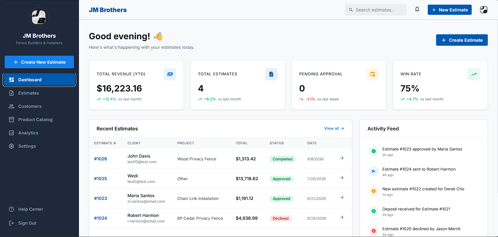
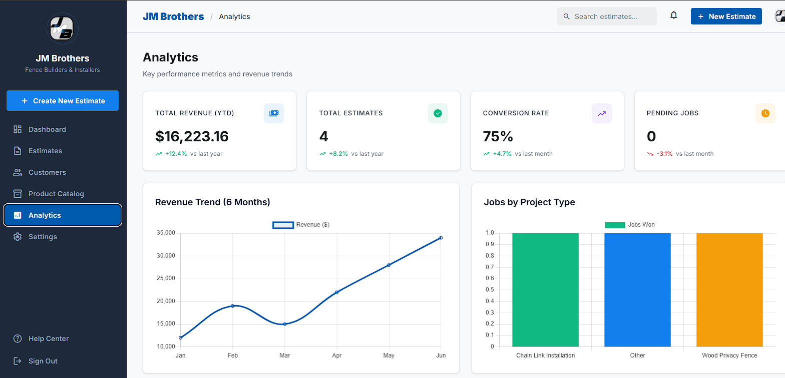
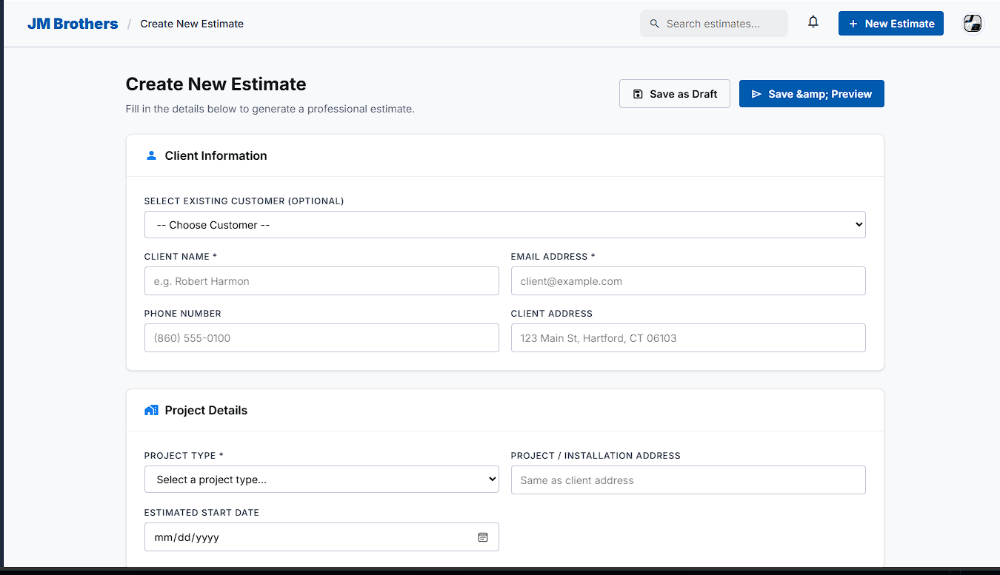
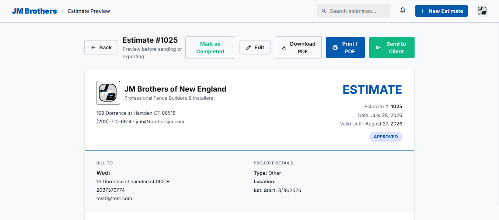
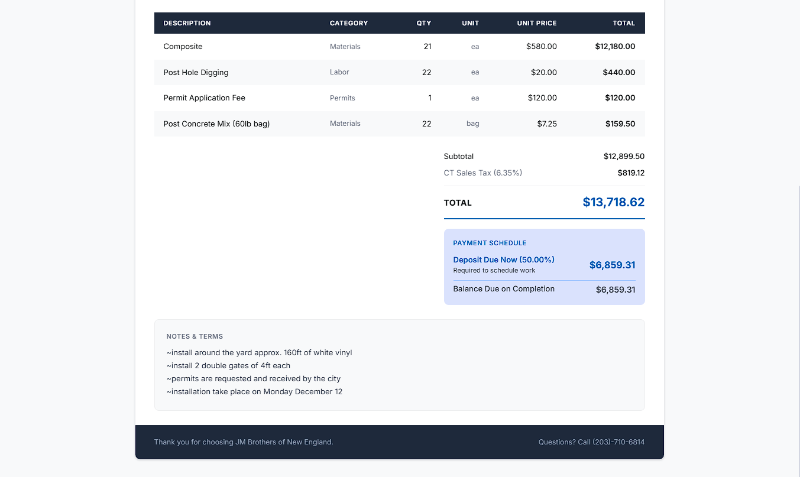
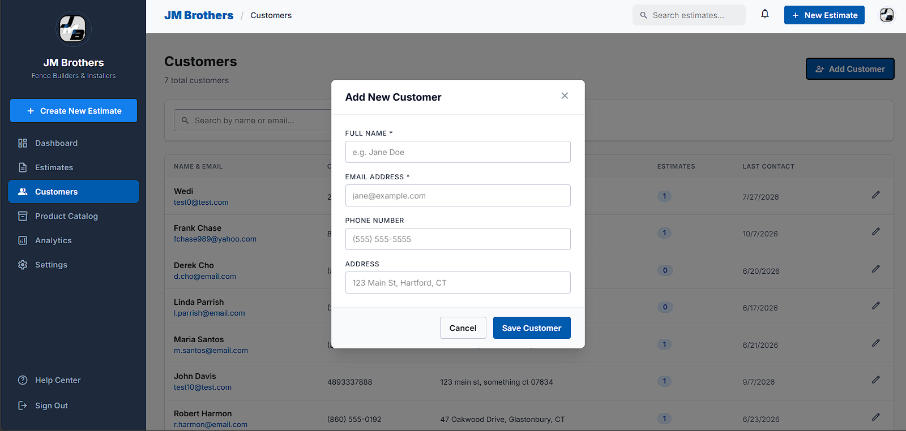
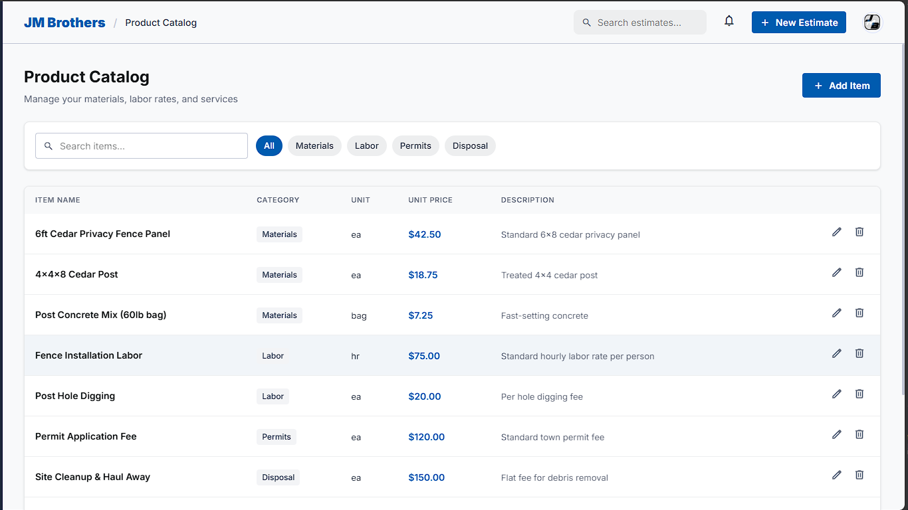
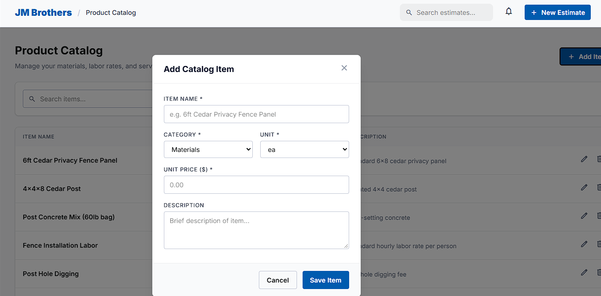
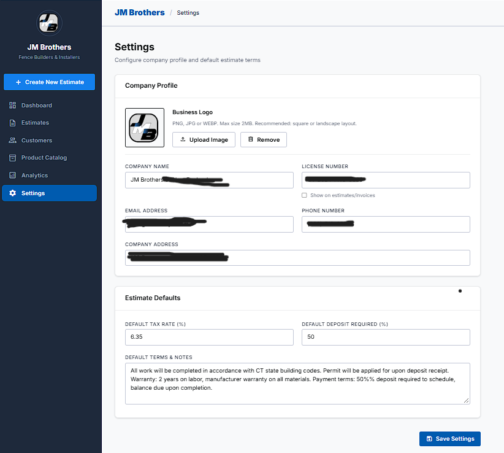
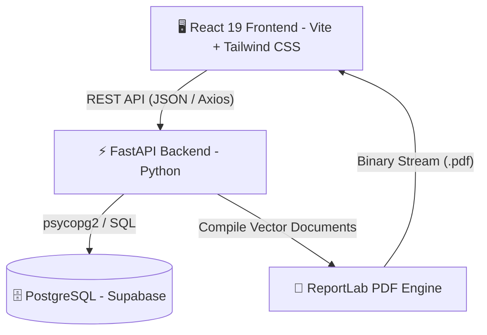

#Wedinson Jimenez
# EstimateAppForBusiness

# 🏗️ JM Brothers Estimate Suite
### Enterprise Contractor Quoting, CRM & Analytics Platform

  <strong>A full-stack, industry-tailored quote generation, client management, and business intelligence platform built for modern fence construction and contracting enterprises.</strong>

---

> 🔒 **Proprietary Software Notice**: This public repository serves as a visual and technical portfolio showcase. Source code is maintained in a private repository to protect commercial intellectual property.

---

## 📌 Overview

**JM Brothers Estimate Suite** was engineered to solve the operational bottleneck faced by trade contractors: slow, error-prone manual calculations and fragmented invoicing. 

This platform streamlines the entire sales-to-close pipeline:
1. Building accurate, multi-tier construction estimates in minutes.
2. Automating linear footage, materials, labor, markup, and tax formulas.
3. Generating professional, print-ready PDF invoices for clients on demand.
4. Tracking customer relationships, conversion rates, and revenue metrics in real-time.

---

## 📸 Application Showcase

> *Tip: Match the filenames below with the images uploaded to your repository (e.g., `./screenshots/` or root folder).*

### 📊 1. Executive Analytics & Dashboard
*Real-time business intelligence tracking total revenue, win rates, pending estimates, and sales distribution.*

  

  

---

### ⚡ 2. Dynamic Estimate Builder & Pricing Engine
*Live multi-item calculation with support for materials, linear footage, custom labor, hardware, permits, and deposit rules.*

  

---

### 📄 3. Client Estimate Preview & Instant PDF Export
*Clean, client-ready invoice preview with automated PDF generation powered by a Python backend engine.*

  

  

---

### 👥 4. Customer Directory & CRM
*Comprehensive client directory tracking historical estimates, contact details, and client lifetime revenue.*

  

---

### 📦 5. Material & Product Catalog
*Centralized pricing database for fencing materials (wood, vinyl, chain link, aluminum), gates, labor rates, and permits.*

  

  

---

### ⚙️ 6. Company Branding & Business Settings
*Customizable sales tax percentages, default deposit rules, custom legal notes/disclaimers, and company logo uploads.*

  

---

## ✨ Key Capabilities & Features

### 📐 Dynamic Estimation Engine
- **Field-Tailored Calculations**: Calculates materials based on linear footage, post spacing, gate counts, and hardware requirements.
- **Automated Financial Rollups**: Live updates for Subtotal, Material Costs, Labor Costs, Custom Markup %, Taxes, and Required Deposit.
- **Revision Control & Duplication**: Easily duplicate existing estimates for returning clients or create quick revisions.

### 📄 Automated PDF Invoice Generation
- **Programmatic Vector Rendering**: Uses ReportLab on the FastAPI backend to render high-resolution, vector-crisp PDF quote sheets.
- **Branded Layout**: Incorporates company logo, client information, line items table, deposit requirements, and signature blocks.

### 📈 Business Intelligence & Analytics
- **KPI Metrics**: Instant visibility into monthly revenue, total quote volume, win rate %, and average estimate ticket size.
- **Interactive Visualizations**: Powered by Chart.js (monthly revenue progression, project type distribution, estimate status funnels).

### 🗂️ Integrated Contractor CRM
- **Centralized Client History**: Instant access to every proposal, status (Draft, Sent, Approved, Declined), and total revenue per client.
- **One-Click Actions**: Duplicate, preview, edit, or generate PDF proposals directly from the customer ledger.

### 🛠️ Product & Material Inventory Catalog
- **Multi-Category Support**: Pre-configured categories for Materials, Labor, Equipment, Permits, and Disposal.
- **Flexible Pricing Units**: Supports linear feet (`LF`), fixed items (`each`), hourly labor (`hr`), and bulk allowances.

---

## 💻 Tech Stack & Architecture

### **Frontend**
- **Framework**: React 19 (Single Page Application)
- **Tooling**: Vite 8 (Ultra-fast HMR and optimized production bundling)
- **Styling**: Tailwind CSS v4 + Vanilla CSS Design Tokens
- **State & Routing**: React Router v7, React Context API
- **Data Visualization**: Chart.js & `react-chartjs-2`
- **Networking**: Axios with centralized HTTP client interceptors

### **Backend**
- **Engine**: Python 3.11+ / FastAPI
- **Web Server**: Uvicorn ASGI
- **Data Validation & Typing**: Pydantic v2 schemas
- **PDF Engine**: ReportLab (Vector document generation)
- **Database Connector**: `psycopg2-binary` with SSL connection pooling

### **Database & Infrastructure**
- **Database**: PostgreSQL (Cloud-hosted via Supabase DB)
- **Relational Models**: Relational schema covering Customers, Estimates, Line Items, Products, and Business Profile.
- **Security**: Strict CORS configuration, sanitized inputs, and environment variable isolation.

---

## 🏛️ System Architecture

---

## 💼 Business Impact

- **⏱️ 80% Time Reduction**: Cut down quote generation time from 45 minutes of manual calculation to under 5 minutes.
- **🎯 Elimination of Pricing Errors**: Pre-set catalog items and automated formulas eliminate under-quoting and mathematical mistakes.
- **💼 Professional Impression**: Instant, high-resolution PDF proposals increase customer trust and close rates.
- **📊 Operational Clarity**: Business owners have immediate visibility into monthly performance and conversion funnels.

---

## 🔒 Source Code & License

The source code for this application is **private and proprietary** to protect business logic, calculation algorithms, and commercial assets.

- **Author**: JM Brothers / Development Team
- **Inquiries**: For questions, collaboration, or custom software inquiries, please reach out via [GitHub Profile](https://github.com/Jwedinson001) or [LinkedIn](www.linkedin.com/in/wedinson-jimenez-7608301a3).

---

  Developed with passion for modern craftsmanship & software excellence.

